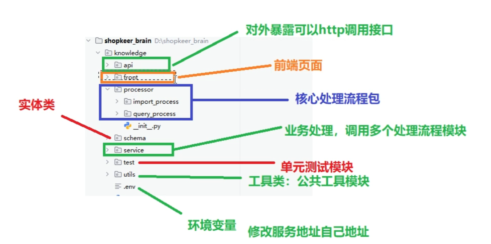
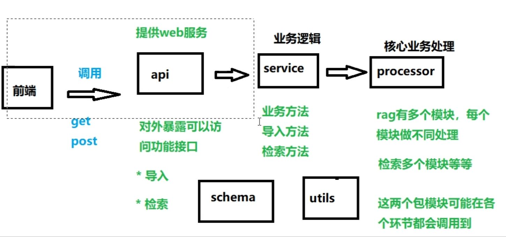
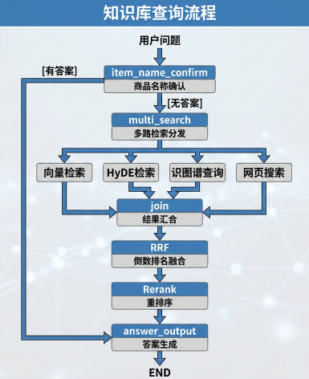

| MVC 角色          | 项目目录         | 干什么                                   |
|-----------------|--------------|---------------------------------------|
| Controller（控制器） | `api/`       | 接收外部请求，调用后面各层，把结果返回出去                 |
| Model（数据模型）     | `schema/`    | 定义数据结构，以及背后 Milvus/Neo4j/MongoDB 里的数据 |
| View（视图）        | `front/`     | 面向用户的界面或交互入口                          |
| Service（流程编排）   | `service/`   | 把一串步骤编排成流水线                           |
| 核心逻辑            | `processor/` | 核心业务规则                                |
| 工具层             | `utils/`     | 工具层                                   |

# 知识库的查询流程

1. 用户通过前端界面上传文件，文件上传成功后，返回任务ID给用户
2. 用户使用任务ID查询任务状态，如果任务未完成，则等待
3. 任务完成后，用户再次查询任务状态，如果任务完成，则返回结果给用户
4. 用户下载结果文件

商品名确认
用户：我的手机如何使用？
LLM：你的问题无法识别
进入商品名称确认
用户：苹果16

多路检索分发
1.向量检索
2.HyDE检索 （语义检索）
先生成假设答案再检索

3.知识图谱查询（可选）
4.网页查询

join 结果汇合
RRF 粗排
reranker 精排

可选：
多路召回
BM25 / 向量ANN / 知识图谱 / 标签 / 时效性 …
        │  各返回 top-K（几百~几千），分数量纲不一
        ▼
① 融合去重（Fusion）        ← 候选量不变或略降，只做"归一 + 合并"
        ▼
② 粗排 / 候选裁剪           ← 千级 → 百级，轻量、可批量
        ▼
③ 精排 Rerank               ← 百级 → 几十，逐条或逐对算，贵但准
        ▼
④ 重排 + 业务规则            ← 几十 → 最终几条~几十条
        ▼
   最终返回