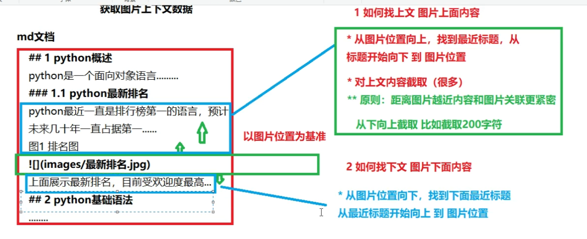
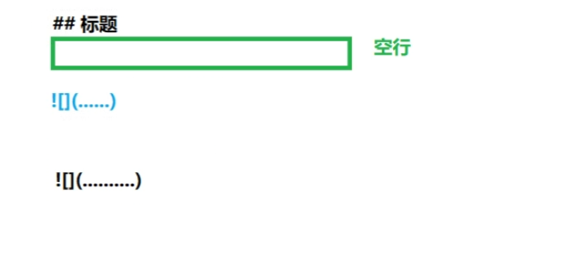
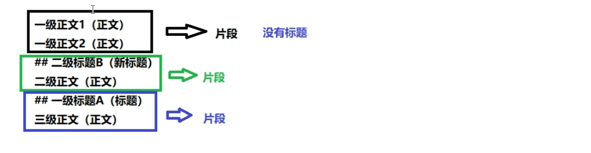

## 上下文切分的方式
原则上对图片前面的字符获取多，离图片近的文字获取的多，离得近的和图片相关的可能性越大

## 截取的最大长度的内容

将图片上传到图片服务器minio，返回可访问的网络路径，嵌入到md文档中
也可以选择存入云厂商，例如ali oss

## Minio操作
1. 创建bucket 
2. 设置权限
将策略设置为pubic，默认为private

# 文档切分

## 多路召回
单一搜索方式得到的结果不一定令人满意，综合多种搜索方式返回更精确的结果
用户问题
   │
   ├─ 路1：向量检索（语义）────┐
   ├─ 路2：BM25 关键词检索 ────┤
   ├─ 路3：按标签/时间/权限过滤─┤→ 合并 → 去重 → 重排(Reranker) → TopK → 塞进 Prompt
   ├─ 路4：实体链接 → 知识图谱 ─┤
   └─ 路5：FAQ 精确命中/热榜 ───┘

### 依据标题切分
逐行处理
读到标题，标记，开始收集正文内容
读到新的标题，结束收集，成为第一个片段

有特殊情况：可能前面几行没有标题直接是正文
