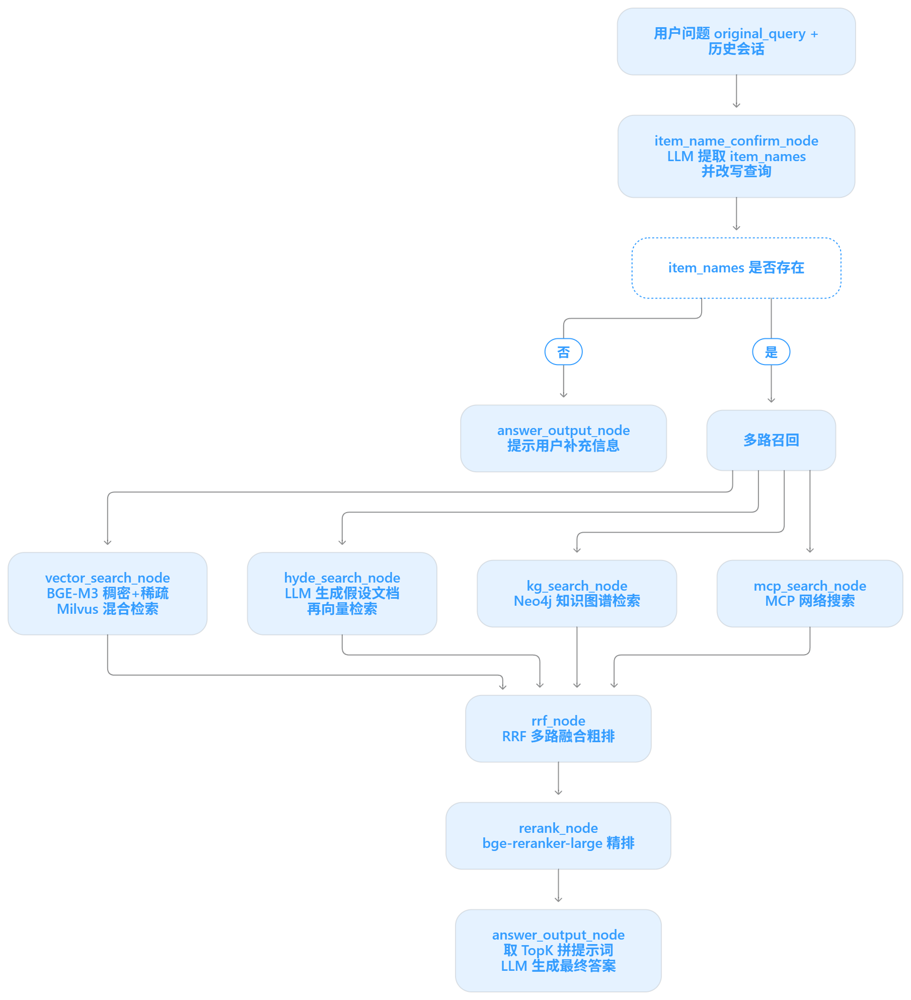

mongodb管理工具
congodb compass工具

知识库项目检索 流程
1. 商品名确认
2. 多路检索
3. 多路结果RRF
4. 生成答案

商品名确认模块

输入问题 --> 获取输入的问题，进行相关处理
处理包括：
1. 用户输入问题很随意
商品名确认，具体商品是什么，型号 
如何进行商品名确认：
1）根据当前上下文会话记录，调用LLM提取商品名称
2）根据LLM提取商品名称，查询向量数据库查询匹配度高的，在向量数据库匹配度高的结果
评分对齐  
    |
分数差异性过滤

评分对齐
用户搜：“RRF 是粗排吗”

你有两路召回：
text
BM25 路（Elasticsearch）
  文档A:  BM25 = 18.3
  文档B:  BM25 = 6.7

向量路（ cosine ）
  文档A:  cos = 0.71
  文档B:  cos = 0.68
翻译成同一种语言——先统一方向，再统一尺度，真正讲究的话统一成“相关概率”。不做这一步，任何加权融合都是在拿苹果乘橘子。
评分阈值

分数的差异性过滤
评分对齐，得到多个匹配商品名，执行
评分最高者和其他候选者分数不能超过一定的阈值

LLM可能提取不出商品名 也可能提取多个商品名
1.确认商品名是一个，重写用户问题
2.提取不出，返回当前问题无法识别
3.返回多个商品名让用户选择：

整体架构图
